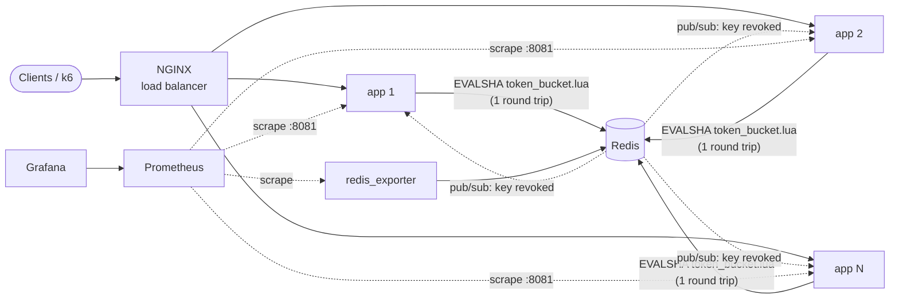

# API Rate Limiter

A distributed API rate limiter built on Spring Boot 3.5 (Java 21, virtual threads) and Redis.
Any number of stateless instances share one Redis. Each limit check is one atomic Lua script, so a
key never gets more than its limit, however many instances are serving it.

It comes with the pieces you'd want around a limiter in production: API keys stored as hashes, an
admin API, a circuit breaker with a fail-open/fail-closed setting, Prometheus metrics with a Grafana
dashboard, a hardened Docker Compose stack, and k6 load tests with measured numbers.



## Highlights

| | |
|---|---|
| **Atomic, distributed** | Each check is one Lua script, so read, refill and decrement can't race. Tested with 1,500 concurrent requests from 3 separate connections, plus 300 concurrent requests through NGINX to 3 containers: exactly the limit is allowed. |
| **One clock** | The scripts read time with `redis.call('TIME')`, so app servers with drifting clocks still agree on refills. |
| **Cluster-ready keys** | Keys look like `rl:{key_id}:tb:<plan>`. The `{hash tag}` keeps a client's keys in one Redis Cluster slot, and each script touches only one key. |
| **Two algorithms** | A token bucket with continuous (fractional) refill, and a sliding window counter (weighted current and previous window, O(1) memory). Each plan picks one. |
| **Plans per key** | `free`, `pro`, `partner` and `enterprise` are configured in YAML and assigned per key. Changing a key's plan takes effect immediately. |
| **Secure API keys** | 256-bit random keys stored only as HMAC-SHA256 with a server-side pepper. The secret is shown once, when the key is created. |
| **Fast key auth** | A local Caffeine cache, including short-lived caching of unknown keys, so a valid request costs one Redis call. Revocations reach every instance immediately via Redis pub/sub. |
| **Resilience** | A Resilience4j circuit breaker around Redis with 250ms timeouts. Fail-open (default) or fail-closed is a config setting. Readiness doesn't depend on Redis. |
| **Standard responses** | `RateLimit-Limit`, `RateLimit-Remaining`, `RateLimit-Reset`, `RateLimit-Policy` (IETF draft) and `Retry-After`. Errors are RFC 9457 `application/problem+json`. |
| **Observable** | Decision latency histograms, decisions by plan and outcome, auth failures, breaker state and cache hit ratio. Comes with a provisioned Grafana dashboard and Prometheus alert rules. |
| **Measured** | k6 runs at a fixed arrival rate (open model, so slow responses aren't under-counted), with a baseline vs limited comparison. |

## Quick start

Requires Docker with Compose. On a Mac, Docker Desktop or `brew install colima docker docker-compose && colima start --cpu 6 --memory 8`.

```bash
./scripts/init-env.sh                 # writes .env with random secrets (gitignored)
docker compose up -d --build --wait   # NGINX + 3 app replicas + Redis + Prometheus + Grafana
```

| URL | What |
|---|---|
| http://localhost:8080 | The API (through NGINX) |
| http://localhost:3000 | Grafana: user `admin`, password `GRAFANA_ADMIN_PASSWORD` from `.env` |
| http://localhost:9090 | Prometheus |

All ports bind to `127.0.0.1` only.

### Try it

```bash
source .env

# Create a key (the secret is only ever returned here)
curl -s -X POST localhost:8080/admin/keys \
  -H "Authorization: Bearer $ADMIN_TOKEN" -H 'Content-Type: application/json' \
  -d '{"owner":"acme","plan":"free"}'
# {"id":"key_…","apiKey":"rlk_…","owner":"acme","plan":"free","createdAt":"…"}

KEY=rlk_...   # paste the apiKey value
for i in $(seq 1 12); do curl -s -o /dev/null -w "%{http_code} " -H "X-API-Key: $KEY" localhost:8080/api/hello; done
# 200 200 200 200 200 200 200 200 200 200 429 429
```

```
HTTP/1.1 429
RateLimit-Limit: 10
RateLimit-Remaining: 0
RateLimit-Reset: 60
RateLimit-Policy: 10;w=60
Retry-After: 6
Content-Type: application/problem+json

{"type":"about:blank","title":"Too Many Requests","status":429,"detail":"Rate limit of plan 'free' exceeded"}
```

### Run without Docker

```bash
brew install redis && brew services start redis
./gradlew bootRun        # uses the "local" profile with dev-only secrets
```

## API

| Method | Path | Auth | |
|---|---|---|---|
| `GET` | `/api/hello` | `X-API-Key` | Sample protected endpoint |
| `GET` | `/api/me` | `X-API-Key` | The calling key's plan and limits |
| `GET` | `/public/ping` | none | Unprotected (used as the benchmark baseline) |
| `GET` | `/admin/plans` | Bearer | Configured plans |
| `POST` | `/admin/keys` | Bearer | Create a key: `{"owner": "...", "plan": "free"}` |
| `GET` | `/admin/keys` | Bearer | List keys (never includes secrets) |
| `GET` | `/admin/keys/{id}` | Bearer | One key |
| `PATCH` | `/admin/keys/{id}` | Bearer | Change plan: `{"plan": "pro"}` |
| `DELETE` | `/admin/keys/{id}` | Bearer | Revoke (takes effect on every instance) |

Actuator (`/actuator/health/{liveness,readiness}`, `/actuator/prometheus`) is served on the
**management port 8081** only. NGINX returns 404 for `/actuator`.

## Plans

Defined in [application.yml](src/main/resources/application.yml):

| Plan | Algorithm | Limit |
|---|---|---|
| `free` | token bucket | burst 10, refills 10/min |
| `pro` | token bucket | burst 100, refills 50/s |
| `partner` | sliding window | 1000 per rolling minute |
| `enterprise` | token bucket | effectively unlimited (used for benchmarks) |

## Benchmarks

Measured with k6 using a constant arrival rate for 30s per step, through NGINX to 3 app replicas and
one Redis. **Everything, including k6, shares one 6-vCPU Colima VM on an Apple Silicon laptop**, so
treat these as relative numbers, not a capacity guarantee. `limited` is `/api/hello`: API key auth,
one Lua script call to Redis, then the controller. `baseline` is `/public/ping` on the same stack
without the limiter.

| Target req/s | Endpoint | Achieved | p50 | p95 | p99 | Errors | Dropped |
|---:|---|---:|---:|---:|---:|---:|---:|
| 4,000 | baseline | 4,000 | 0.15 ms | 0.27 ms | 0.50 ms | 0% | 0 |
| 4,000 | limited | 4,000 | 0.26 ms | 0.33 ms | 0.98 ms | 0% | 0 |
| 8,000 | baseline | 8,000 | 0.14 ms | 0.20 ms | 1.18 ms | 0% | 0 |
| 8,000 | limited | 8,000 | 0.28 ms | 0.54 ms | 4.02 ms | 0% | 0 |
| **12,000** | **limited** | **12,000** | **0.32 ms** | **1.00 ms** | **5.20 ms** | **0%** | **0** |
| 16,000 | limited | 15,985 | 0.42 ms | 5.04 ms | 25.6 ms | 0% | 445 |
| 20,000 | limited | 19,857 | 0.66 ms | 42.9 ms | 217 ms | 0% | 4,525 |

- **The limiter adds about 0.1–0.2 ms at the median.** That's the cost of one Redis round trip.
- **About 12k req/s is the sustainable ceiling on this machine** with p99 under 10 ms. Past about 16k, the VM's CPUs are saturated (k6, NGINX, 3 JVMs and Redis all share 6 vCPUs), latency climbs and k6 starts dropping requests. Baseline is still fine at 20k, so the limit is CPU for the extra work, not a lock or contention problem.
- **Correctness under load:** `correctness.js` sends 300 requests at once with one `free` key. NGINX spreads them over all 3 instances (about 100 each), and exactly 10 succeed.
- **Redis outage under load:** at 2,000 req/s, Redis was stopped for 15s, then started again. All requests returned 200, p99 stayed at 1.7 ms, and 0 errors were reported. Each instance's breaker opened within a second, probed every 5s, and closed once Redis was back.

**Warm up first.** Right after a restart the JVMs haven't JIT-compiled the hot path yet. A
20k run on cold JVMs reached only 14k req/s with p99 over 1 s; the same run a minute later
reached 19.8k req/s. Run a short load at low rate before measuring.

Reproduce:

```bash
docker compose --profile loadtest run --rm k6 run /scripts/correctness.js
RATES="4000 8000 12000 16000" ./loadtest/run-benchmark.sh   # prints the table above
```

During a run, open the Grafana dashboard. It shows requests per instance, decision latency
percentiles, allowed vs denied counts, breaker state and Redis operations/sec, with k6's own metrics
alongside.

## Testing

```bash
./gradlew test    # needs Docker: Testcontainers starts a throwaway Redis
```

With Colima, point Testcontainers at its socket first:

```bash
export DOCKER_HOST="unix://$HOME/.colima/default/docker.sock" TESTCONTAINERS_DOCKER_SOCKET_OVERRIDE=/var/run/docker.sock TESTCONTAINERS_RYUK_DISABLED=true
```

| Suite | Covers |
|---|---|
| `RedisTokenBucketRateLimiterIT` | Burst then deny, accurate `Retry-After`, continuous refill, capacity cap, cost, TTL, hash tags |
| `RedisSlidingWindowRateLimiterIT` | Per-window limit, weight of the previous window after rollover, full reset, `Retry-After` accuracy |
| `DistributedConcurrencyIT` | 1,500 simultaneous requests over 3 connections allow exactly the limit (both algorithms) |
| `ApiFlowIT` | End to end over HTTP: key lifecycle, 429s, plan change, revocation, pub/sub invalidation, admin auth and validation, actuator isolation, metrics |
| `ApiRateLimitFilterTest` | Default deny, 401/429/503 paths, headers, fail-open/closed, dot-segment bypass attempts |
| `RateLimitServiceTest` | Fail-open/closed, circuit breaker opening and short-circuiting, metrics |
| `loadtest/k6/correctness.js` | 300 concurrent requests through NGINX to 3 containers: exactly 10 allowed |

CI ([.github/workflows/ci.yml](.github/workflows/ci.yml)) runs the test suite, then starts the
whole Compose stack and runs the k6 correctness and throughput smoke tests against it.

## Design notes

**Why Lua and not `INCR` + `EXPIRE`?** A token bucket needs read, refill, compare and write as one
step. Spring sends `EVALSHA`, so after the first call only the script's SHA goes over the wire.

**Token bucket vs sliding window.** A token bucket allows bursts up to capacity and then a steady
rate. That suits APIs where clients batch. A sliding window counter caps requests in any rolling
window. It's an approximation (it assumes the previous window's requests were evenly spread), which
avoids storing a log of every request.

**Fail-open by default.** If Redis goes away, rejecting all traffic is usually worse than briefly not
limiting it. Lookups time out after 250ms. After repeated failures the circuit breaker opens and
requests skip Redis entirely for 5s, then it probes again. Requests decided this way are counted as
`fail_open`, and an alert fires. Set `ratelimit.fail-mode: closed` to return 503 instead.

**API key auth during a Redis outage.** Keys stay valid in each instance's cache for 10 minutes
(`api-key-cache.expire-after`) and refresh every 30s. If a refresh fails, the cached value is kept.
Unknown keys get 503 while Redis is down, because they can't be checked.

**Changing a key's plan** gives it a fresh bucket, because the bucket key includes the plan name.

**Redis memory.** Every bucket has a TTL that expires once it would be full again, and an absent
bucket counts as a full one. Redis runs with `maxmemory-policy volatile-ttl`, so under memory
pressure it evicts rate limit state, never API keys.

## Security

- API keys: 256-bit `SecureRandom`, stored only as HMAC-SHA256 with `API_KEY_PEPPER`. The secret is returned once with `Cache-Control: no-store`. Unknown, malformed and revoked keys all get the same 401, so the response doesn't reveal which keys exist.
- Admin API: bearer token of at least 32 characters, compared in constant time. The admin API is disabled (404) if no token is set. NGINX also limits `/admin` to 10 requests/s per IP. Every key change is written to the `audit` log.
- Default deny: every path except `ratelimit.public-paths` needs a key. Paths with dot segments (`/public/../api`, including encoded forms) are rejected.
- The app won't start without a strong pepper and admin token. It never logs secrets, and errors never include stack traces or messages.
- Containers: the app runs as a non-root user on a read-only filesystem with all capabilities dropped and `no-new-privileges`. Redis requires a password and isn't published to the host. Every port binds to localhost.
- Secrets live in `.env` (mode 600, gitignored). `scripts/init-env.sh` generates them.

For a real deployment, add TLS in front of NGINX, Redis ACL users and TLS, and a secrets manager in place of `.env`.

## Project layout

```
src/main/java/.../ratelimit/       Plan, RateLimitService (breaker, fail mode, metrics)
src/main/java/.../ratelimit/redis/ Token bucket + sliding window limiters
src/main/resources/scripts/        The Lua scripts
src/main/java/.../apikey/          Key issuing, HMAC hashing, Redis repository, cache
src/main/java/.../admin/           Admin API + bearer auth filter
src/main/java/.../web/             The API key + rate limit filter
deploy/                            NGINX, Prometheus (+ alerts), Grafana provisioning + dashboard
loadtest/                          k6 scripts and the benchmark runner
```

## Roadmap

- Redis Cluster in Compose, and benchmarks with sharding
- Local token leasing for very hot keys (fewer Redis round trips, slightly looser limits)
- Per-route request cost (e.g. an expensive endpoint costs 5 tokens). `RateLimitService` already supports cost
- Envoy external rate limit (gRPC) adapter so it can sit behind an existing gateway
